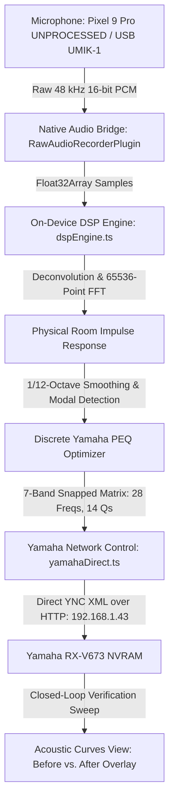

# Acoustic Engine & Android Calibration Architecture

## System Overview

The system is a dedicated, standalone Android mobile calibration and room correction suite for home listening environments (Yamaha RX-V673 AVR + Q Acoustics 3020i + Focal Cub Evo subwoofer). It operates autonomously on the local Wi-Fi network without requiring an external PC, terminal session, or background Python daemon.

---

## On-Device DSP & Farina Deconvolution (`frontend/src/services/dspEngine.ts`, `fftEngine.ts`)

Acoustic curve calculation runs deterministically on-device using Angelo Farina's synchronous logarithmic sine sweep technique. Every displayed curve derives directly from physical acoustic measurements—zero synthetic or randomized approximations exist in the pipeline.

1. **Excitation & Capture**: A 5-second logarithmic sine sweep (15 Hz to 22,000 Hz at 48 kHz) plays through the receiver (via direct 3.5mm/USB-C AUX line-out or UPnP/DLNA Wi-Fi casting) while the phone captures uncompressed 16-bit PCM audio.
2. **Deconvolution via FFT Convolution**:
   $$h(t) = y(t) * s^{-1}(t)$$
   The recorded audio buffer is convolved with the theoretical inverse sweep filter $s^{-1}(t)$ using an in-place Radix-2 Cooley-Tukey Real-FFT algorithm (`fftEngine.ts`), producing the Room Impulse Response (RIR).
3. **Causal Windowing**: Direct sound arrival is located via peak thresholding. A temporal window spanning $-10\text{ ms}$ (pre-causal Hann taper) to $+500\text{ ms}$ (post-causal tail) isolates the room's direct and early reflected acoustic energy.
4. **Spectral Extraction**: A 65,536-point Real-FFT extracts the frequency magnitude response, followed by standard 1/12-octave psychoacoustic smoothing.

---

## Hardware Parameter Quantization & Safety Invariants

The Yamaha RX-V673 digital signal processor accepts only discrete hardware parameter steps. The optimizer (`optimizeStereoPEQ`) strictly constrains every generated biquad band to valid hardware values:

* **Discrete Center Frequencies (28 bands)**: $31.3\text{ Hz}$ to $16,000.0\text{ Hz}$ (`YAMAHA_FREQS`).
* **Discrete Quality Factors (14 values)**: $0.500$ to $10.080$ (`YAMAHA_QS`).
* **Asymmetric Gain Clamping**:
  * Maximum boost ceiling: $+3.0\text{ dB}$ (prevents amplifier clipping and driver distortion).
  * Maximum cut floor: $-12.0\text{ dB}$ (effective modal standing wave attenuation).
  * Quantization step: $0.5\text{ dB}$.
  * Schroeder frequency threshold: Above $500.0\text{ Hz}$, maximum boost is strictly $0.0\text{ dB}$ to prevent comb-filter overcompensation in non-minimum phase zones.
* **Filter Band Count**: Exactly 7 parametric bands per channel (`Front_L` and `Front_R`). Unallocated bands are programmed as transparent pass filters ($0.0\text{ dB}$).

---

## Hardware Control & Disaster Recovery (`frontend/src/services/yamahaDirect.ts`, `avrRollback.ts`)

* **Direct YNC Protocol over HTTP**: The mobile app communicates with the receiver at `http://192.168.1.43/YamahaRemoteControl/ctrl` using `CapacitorHttp`. This bypasses browser Cross-Origin Resource Sharing (CORS) restrictions natively on Android.
* **Reactive Master Volume Debouncing**: Master volume adjustments use a 60 ms sliding window debounce to prevent HTTP connection pool exhaustion on the receiver while maintaining instant reactive dial feedback.
* **Pre-Flight Snapshot & Rollback**: Before any hardware configuration begins, `avrRollback.ts` reads the complete receiver state (`Pattern_1` PEQ matrix, volume, input selector, and PEQ mode) and persists it locally. If calibration is cancelled or interrupted, a single tap restores the saved state within 2 seconds.

---

## Dedicated Mobile Interface Architecture

The mobile application eliminates auxiliary streaming bloat and provides a focused 4-view navigation model:

1. **Calibrate View (`CalibrateView.tsx`)**: 5-step guided calibration flow covering topology selection (2.0 stereo or 2.1 with Focal Cub Evo subwoofer), single- or multi-point sweep captures, crossover and phase alignment, discrete PEQ optimization, and hardware deployment.
2. **AVR Remote View (`AvrRemoteView.tsx`)**: Dedicated hardware control surface with a $\pm 0.5\text{ dB}$ haptic volume dial, input selector, power toggle, and instant A/B PEQ auditioning switch (`Manual` calibrated vs. `Through` bypass vs. `YPAO Flat`).
3. **Acoustic Curves View (`AcousticCurvesView.tsx`)**: High-resolution interactive chart rendering the 4-layer comparison overlay (Pre-calibration baseline, Target curve, Biquad filter transfer response, and Post-calibration verification) along with identified room mode standing waves ($< 500\text{ Hz}$).
4. **History View (`HistoryView.tsx`)**: Local session archives, profile comparison, 1-tap re-deployment, and CSV curve data export.
