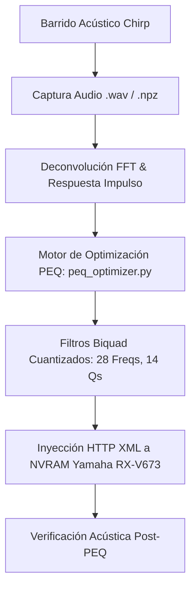

# Arquitectura del Motor Acústico y DSP

## Visión General del Sistema

El proyecto proporciona una cadena completa de corrección acústica de sala de alta fidelidad, basada exclusivamente en mediciones FFT reales deconvolucionadas y optimización paramétrica adaptada a las limitaciones de hardware del receptor Yamaha RX-V673.

## Motor de Optimización PEQ (`scripts/peq_optimizer.py`)

El motor de ecualización funciona en dos etapas sin recurrir a suposiciones sintéticas:

1. **Identificación de Resonancias Modales**: Detección de picos de resonancia en baja frecuencia con `scipy.signal.find_peaks`.
2. **Ajuste No Lineal Restringido**: Optimización por mínimos cuadrados restringidos contra curvas objetivo reconocidas (Harman, B&K 1974, Flat).

### Restricciones de Hardware y Reglas Acústicas

* **Cuantización Fija**:
  * 28 frecuencias discretas: de 31.3 Hz hasta 16000.0 Hz.
  * 14 factores de calidad Q: de 0.500 a 10.080.
* **Límites de Ganancia Asimétrica**:
  * Boost máximo permitido: `+3.0 dB`.
  * Corte máximo permitido: `-12.0 dB`.
  * Paso de ganancia: `0.5 dB`.
  * Frecuencia de Schroeder: `500.0 Hz` (0.0 dB de boost permitido por encima de 500 Hz para evitar coloración en agudos).
* **Independencia de Canales**: Optimización desacoplada $f_{0,L} \neq f_{0,R}$ para corregir asimetrías acústicas en los límites de la sala.

## Servidor Web y Control del Receptor (`scripts/web_calibration_server.py`)

* **Servidor HTTPS (`PORT: 53317`)**: Permite la interacción desde dispositivos móviles en la red local.
* **API de Control Yamaha**: Envío de comandos XML mediante llamadas HTTP a los endpoints del receptor Yamaha para configurar volúmenes, entradas y bancos de memoria PEQ.
