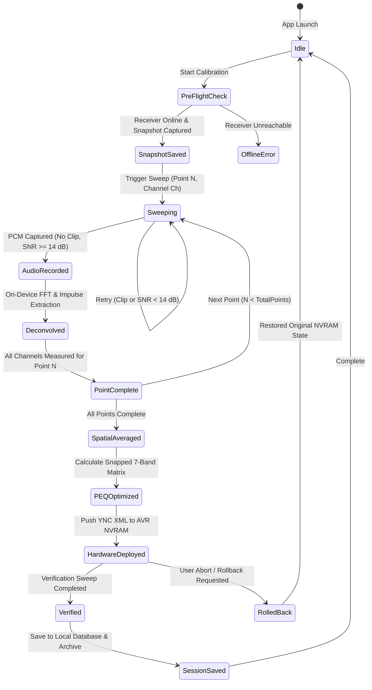

# Phase 1 Data Model: Professional Standalone Android Acoustic Calibration Suite

**Feature Branch**: `012-pro-android-calibration`
**Date**: 2026-10-09

## Entities & Schemas

### 1. AcousticMeasurement
Represents a single audio capture event for a specific audio channel at a specific spatial location.

| Field | Type | Description | Validation / Constraints |
|---|---|---|---|
| `id` | `string` | Unique capture identifier | UUID v4 |
| `pointIndex` | `number` | Measurement point index | $1 \le \text{pointIndex} \le 5$ |
| `channel` | `enum` | Audio channel designation | `'Front_L' \| 'Front_R' \| 'Subwoofer'` |
| `timestamp` | `number` | Capture timestamp in ms | Epoch milliseconds |
| `sampleRate` | `number` | Audio sample rate | Strictly $48000\text{ Hz}$ |
| `durationMs` | `number` | Recorded sweep duration | $3000\text{ ms} \le \text{durationMs} \le 8000\text{ ms}$ |
| `peakDbfs` | `number` | Peak signal level in recorded audio | $\le -0.5\text{ dBFS}$ (reject if clipping) |
| `snrDb` | `number` | Signal-to-noise ratio | $\ge 14.0\text{ dB}$ (reject if noisy) |
| `delayMs` | `number` | Time-of-flight acoustic delay | $0.0\text{ ms} \le \text{delayMs} \le 100.0\text{ ms}$ |
| `distanceM` | `number` | Calculated physical speaker distance | $0.30\text{ m} \le \text{distanceM} \le 12.00\text{ m}$ ($0.05\text{ m}$ step) |
| `splDb` | `number` | Peak acoustic sound pressure level | $50.0\text{ dB} \le \text{splDb} \le 105.0\text{ dB}$ |
| `freqs` | `number[]` | Frequency grid points in Hz | Standard 28-band Yamaha or 1/12-octave grid |
| `rawResponseDb` | `number[]` | Unsmoothed FFT magnitude response | Decibels normalized to reference |
| `smoothedResponseDb`| `number[]` | 1/12-octave smoothed response | Decibels normalized to reference |
| `irBufferPath` | `string` | Local filesystem path to impulse response | Sandboxed file path |

---

### 2. SpatialMeasurementPoint
Encapsulates all channel measurements captured at a single physical microphone position.

| Field | Type | Description | Validation / Constraints |
|---|---|---|---|
| `point` | `number` | Position index (1 = sweet spot) | $1 \le \text{point} \le 5$ |
| `label` | `string` | User-friendly position description | e.g., "Punto Central (Sweet Spot)" |
| `measurements` | `Record<string, AcousticMeasurement>` | Channel-keyed measurements | Keys: `'Front_L'`, `'Front_R'`, `'Subwoofer'` |
| `completed` | `boolean` | Indicates if all active channels are measured | `true` if all required channels present |

---

### 3. ParametricFilterBand
Represents one of the 7 hardware biquad filter bands per channel supported by the Yamaha RX-V673 DSP.

| Field | Type | Description | Validation / Constraints |
|---|---|---|---|
| `channel` | `enum` | Target audio channel | `'Front_L' \| 'Front_R'` |
| `band` | `number` | Hardware PEQ band index | Integer $1 \le \text{band} \le 7$ |
| `freqHz` | `number` | Filter center frequency | Must be member of `YAMAHA_FREQS` (28 discrete values) |
| `q` | `number` | Quality / bandwidth factor | Must be member of `YAMAHA_QS` (14 discrete values) |
| `gainDb` | `number` | Filter gain in decibels | Clamped $[-12.0, +3.0]\text{ dB}$ ($0.5\text{ dB}$ steps); $\le 0.0\text{ dB}$ if $f > 500\text{ Hz}$ |
| `role` | `enum` | Acoustic optimization purpose | `'room_mode' \| 'voicing' \| 'tilt'` |

---

### 4. CalibrationSession
Top-level entity storing the complete state of a calibration run.

| Field | Type | Description | Validation / Constraints |
|---|---|---|---|
| `id` | `string` | Unique session ID | UUID v4 |
| `createdAt` | `string` | ISO 8601 creation timestamp | e.g., `"2026-10-09T14:30:00Z"` |
| `topology` | `enum` | Speaker setup topology | `'2.0' \| '2.1'` |
| `numPoints` | `number` | Number of planned measurement positions | $1, 3, \text{ or } 5$ |
| `targetProfileId` | `string` | Acoustic target voicing profile key | e.g., `'harman_wide_room'`, `'bk_1974'` |
| `micProfileId` | `string` | Microphone profile key | e.g., `'pixel_9_pro'`, `'umik1_custom'` |
| `points` | `SpatialMeasurementPoint[]` | Collection of measured points | Length matches `numPoints` |
| `spatialAverage` | `Record<string, number[]>` | Complex vector average per channel | Smoothed frequency response vector |
| `optimizedFilters` | `Record<string, ParametricFilterBand[]>` | 7-band filter set for Left and Right | Exactly 7 bands per active main channel |
| `crossoverHz` | `number` | Subwoofer crossover frequency | Must match receiver crossover setting (e.g., $80.0\text{ Hz}$) |
| `subwooferDelayMs` | `number` | Acoustic phase alignment delay | $\ge 0.0\text{ ms}$ |
| `channelTrims` | `Record<string, number>` | Channel relative level trims | $[-10.0, +10.0]\text{ dB}$ in $0.5\text{ dB}$ steps |
| `preFlightSnapshot`| `ReceiverStateSnapshot` | Pre-calibration backup state | Complete NVRAM state prior to session |
| `verification` | `VerificationAuditRecord?` | Post-calibration verification result | Present if closed-loop verification completed |
| `deployed` | `boolean` | Flag indicating if filters are active in AVR | Default `false` |

---

### 5. ReceiverStateSnapshot
Backup of receiver NVRAM settings before any hardware changes are applied.

| Field | Type | Description | Validation / Constraints |
|---|---|---|---|
| `timestamp` | `number` | Backup capture timestamp | Epoch milliseconds |
| `power` | `string` | Receiver power state | `'On' \| 'Standby'` |
| `input` | `string` | Active input selector | e.g., `'AV4'`, `'V-AUX'` |
| `volumeDb` | `number` | Master volume setting | e.g., $-40.0\text{ dB}$ |
| `peqMode` | `string` | Active PEQ mode | `'Manual' \| 'Through' \| 'YPAO'` |
| `straight` | `boolean` | Straight listening mode active | `true \| false` |
| `peqRawXml` | `string` | Full XML dump of Pattern_1 PEQ matrix | Complete YNC XML payload |
| `volumesRawXml` | `string` | Full XML dump of channel trim levels | Complete YNC XML payload |
| `distancesRawXml`| `string` | Full XML dump of speaker distances | Complete YNC XML payload |

---

### 6. VerificationAuditRecord
Empirical comparative audit artifact establishing the real-world acoustic delta.

| Field | Type | Description | Validation / Constraints |
|---|---|---|---|
| `timestamp` | `number` | Verification capture timestamp | Epoch milliseconds |
| `profileId` | `string` | Active target profile ID | Matches session target |
| `freqs` | `number[]` | Frequency axis points | Standard 28-band or 1/12-octave grid |
| `baselineDb` | `number[]` | Pre-calibration measured curve | Real measured values |
| `targetDb` | `number[]` | Active acoustic target curve | Profile-derived target values |
| `filterResponseDb`| `number[]` | Computed RBJ biquad transfer function | Combined 7-band filter magnitude |
| `verifiedDb` | `number[]` | Post-calibration measured curve | Real measured values (Through $\rightarrow$ Manual) |
| `modalAttenuations`| `Array<{ freqHz: number; reductionDb: number }>` | Quantified room mode dampening | Modes $< 500\text{ Hz}$ with $\ge 3.0\text{ dB}$ reduction |
| `rmsErrorPreDb` | `number` | Root-mean-square error vs target before | Decibels |
| `rmsErrorPostDb`| `number` | Root-mean-square error vs target after | Must satisfy $\text{rmsErrorPostDb} < \text{rmsErrorPreDb}$ |

---

## State Transitions: Calibration Lifecycle

